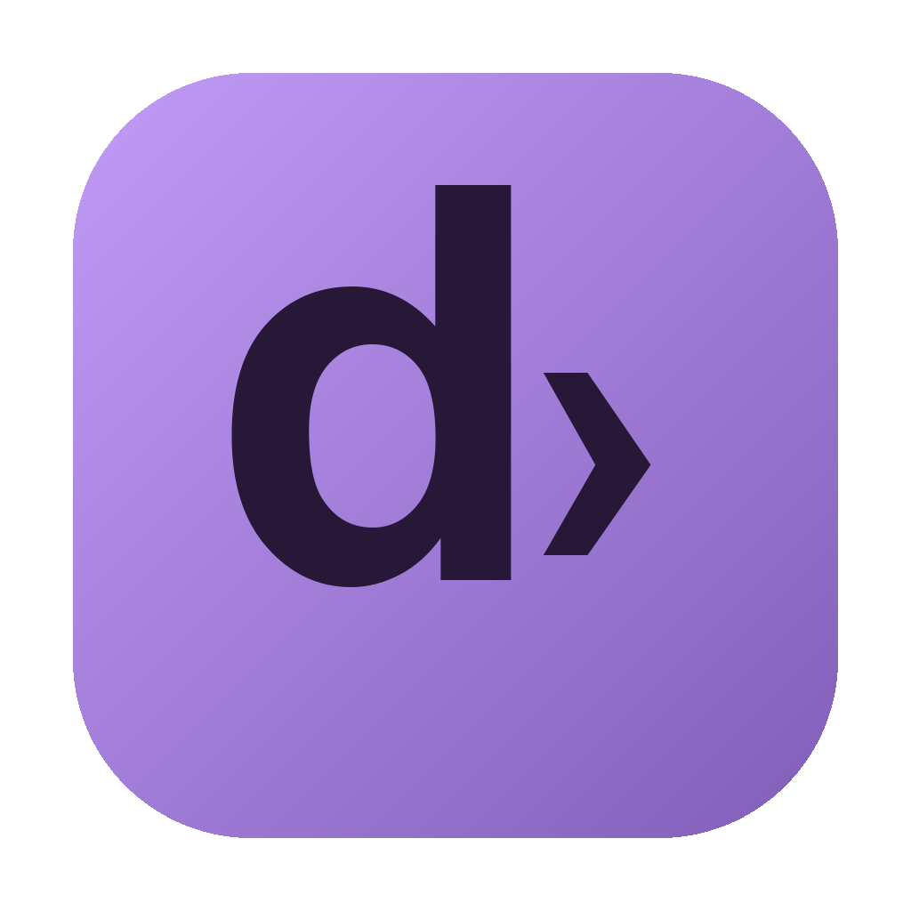

# iDom Launcher

<p align="center"></p>
<p align="center"><strong>Le tue app. Un unico posto.</strong><br>Il launcher di Domenico Colella per iBlock e iVolume.</p>

[](https://github.com/Domenico-lel/iDom-Hub/actions/workflows/release.yml)

## Scarica il launcher

**[Apri l’ultima release](https://github.com/Domenico-lel/iDom-Hub/releases/latest)** e scegli il file per il tuo computer:

| Computer | File |
| --- | --- |
| macOS — Intel e Apple Silicon, un unico file | [Scarica per macOS](https://github.com/Domenico-lel/iDom-Hub/releases/latest/download/iDom-Launcher-macOS.dmg) |
| Windows 64 bit | [Scarica per Windows](https://github.com/Domenico-lel/iDom-Hub/releases/latest/download/iDom-Launcher-Windows.exe) |

**Mac:** apri il DMG e trascina **iDom Launcher** in Applicazioni. **Windows:** apri l’EXE e segui l’installazione guidata. Ci sono soltanto due installer: `iDom-Launcher-macOS.dmg` e `iDom-Launcher-Windows.exe`. I collegamenti **Source code** vengono aggiunti automaticamente da GitHub per gli sviluppatori e non servono per installare il launcher.

Questa è la **prima release**. Firma Developer ID, notarizzazione Apple e certificato Windows non sono ancora configurati: il sistema potrebbe mostrare avvisi all’avvio. Il launcher non disattiva Gatekeeper. Non servono account o token personali per usare i repository pubblici.

## Come funziona

1. All’apertura il launcher cerca le app in `/Applications` e `~/Applications` e controlla le release stabili su GitHub.
2. Premi **Installa**: il download viene verificato con SHA-256 e viene controllata la firma del bundle, poi l’app viene copiata in `~/Applications`.
3. Premi **Apri** per avviare un’app installata.
4. Quando esce una nuova versione compare **Aggiorna**. Chiudi l’app, premi il pulsante e la nuova copia sostituisce quella precedente nella stessa cartella.
5. Il controllo si ripete ogni 15 minuti mentre il launcher è aperto; puoi usare anche **Controlla aggiornamenti**.

Durante la sostituzione viene mantenuta una copia per il ripristino. Se lo scambio o il salvataggio del registro falliscono, viene ripristinata l’app precedente. Viene sostituito solo il bundle `.app`: impostazioni e progetti non vengono eliminati. macOS potrebbe chiedere nuovamente i permessi dopo un aggiornamento.

Se la cartella non è scrivibile, il launcher mostra un errore senza chiedere privilegi amministrativi. Puoi spostare l’app in `~/Applications` e riprovare.

## Interfaccia

La versione 0.2.0 usa un layout compatto sul modello di ArtCraft Launcher: barra superiore, schede squadrate e azioni visibili. Scegli **Griglia** o **Tabella**, filtra per stato e cerca le app. Nelle impostazioni puoi scegliere tema chiaro, scuro o del sistema e attivare il controllo automatico. Le preferenze vengono conservate. Il testo dell’interfaccia non si seleziona; la ricerca resta un normale campo editabile.

Se ci sono nuove versioni, **Aggiorna tutte** esegue gli aggiornamenti in sequenza. Per una copia di iVolume da collegare al launcher usa **Collega al launcher** nei dettagli.

## App disponibili

| App | Funzione | Requisiti |
| --- | --- | --- |
| [iBlock](https://github.com/Domenico-lel/iBlock) | Blocco temporaneo della tastiera e del puntatore per pulire il Mac | macOS 13+, Intel e Apple Silicon |
| [iVolume](https://github.com/Domenico-lel/iVolume) | Volume separato per le applicazioni | macOS 14.2+; la release attuale è Intel e richiede Rosetta su Apple Silicon |

Il launcher è compilato per macOS e Windows. **Le due app attuali sono soltanto macOS** e su Windows risultano non disponibili. L’adattatore per installare future app Windows dovrà essere aggiunto quando esisteranno i pacchetti, scegliendo tra EXE/MSI e ZIP portatili.

## Pubblicare aggiornamenti di iBlock e iVolume

Non devi aggiornare iDom Launcher a ogni release delle due app:

1. Nel repository dell’app aggiorna `CFBundleShortVersionString`, compila e mantieni lo stesso bundle identifier.
2. Pubblica una **GitHub Release stabile**, con un nuovo tag numerico come `v2.3.4` o `v0.9.1`. Le draft e le prerelease non vengono usate dal catalogo.
3. Allega il pacchetto: per iBlock `iBlock-Universale.dmg` oppure `iBlock-Universale.zip`; per iVolume `iVolume.app.zip` oppure `iVolume.dmg`.
4. Il pacchetto deve contenere alla radice `iBlock.app` oppure `iVolume.app`, con firma verificabile. Per lo sviluppo è supportata la firma ad hoc; per il pubblico usa Developer ID e notarizzazione.
5. Il campo `digest` dell’asset GitHub deve contenere SHA-256: un download senza checksum o con checksum errato viene rifiutato.

Gli utenti vedranno **Aggiorna**. Il launcher usa l’endpoint GitHub `releases/latest`, quindi segue l’ultima release stabile selezionata da GitHub.

**iVolume:** la release iniziale usa il tag `iVolume`, senza numero. Per collegare una copia già installata, premi una volta **Collega al launcher** nei dettagli. Da quel momento vengono confrontati anche identificativo della release, del file e checksum. Dalle prossime release usa tag numerici allineati alla versione del bundle.

## Pubblicare una nuova versione del launcher

La procedura [Build and release](https://github.com/Domenico-lel/iDom-Hub/actions/workflows/release.yml) è configurata per compilare e pubblicare:

1. Modifica il codice, incrementa `version` in `package.json` e aggiorna `RELEASE_NOTES.md`.
2. Pusha su `main`.
3. GitHub Actions esegue i test e compila un unico DMG universale per Mac Intel e Apple Silicon e un installer EXE per Windows x64.
4. Se le build passano, crea il tag `vX.Y.Z`, pubblica una release normale e allega soltanto i due installer. I checksum SHA-256 sono mostrati da GitHub accanto ai file.

Per una nuova versione incrementa `version` in `package.json`. Le release che hanno già i due installer corretti non vengono ricompilate. Una release con vecchi pacchetti separati viene aggiornata ai due installer: i file superflui vengono rimossi solo dopo il caricamento riuscito dei nuovi pacchetti. Le eventuali prerelease vengono convertite in release normali. Puoi avviare la procedura anche da **Actions → Build and release → Run workflow**. Un tag inviato manualmente deve corrispondere alla versione del package.

La procedura usa il `GITHUB_TOKEN` temporaneo di Actions; non inserire token personali nel codice. Il permesso di scrittura è limitato ai job che gestiscono la release; le build hanno accesso in lettura. I certificati di firma non sono configurati.

L’aggiornamento del **launcher stesso** non è ancora automatico: gli utenti scaricano il nuovo iDom Launcher da Releases. Gli aggiornamenti di iBlock e iVolume sono gestiti dal launcher.

## Sviluppo

Servono Node.js 24 e pnpm 11.25.0.

```sh
git clone https://github.com/Domenico-lel/iDom-Hub.git
cd iDom-Hub
pnpm install --frozen-lockfile
pnpm exec install-electron
pnpm start
```

```sh
pnpm test
pnpm run build:mac --publish never
pnpm run build:win --publish never
```

`pnpm exec install-electron` prepara il runtime di sviluppo. I file compilati sono in `dist/`. Per l’installer Windows usa Windows o GitHub Actions.

## Struttura e verifiche

- `src/catalog.cjs`: catalogo, repository, requisiti e selezione dei pacchetti.
- `src/main.cjs` e `src/preload.cjs`: finestra e comunicazione IPC.
- `src/manager.cjs`: release, riconoscimento app, download e installazione macOS.
- `src/swap.cjs`: sostituzione e ripristino.
- `src/core.cjs`: versioni, checksum e percorsi ZIP.
- `ui/`: interfaccia italiana con le icone originali.
- `tests/`: dieci test per i casi critici.

Per altre app macOS aggiungi una voce al catalogo con i suoi metadati.

Verificati su macOS: installazione delle release reali in una cartella isolata, sostituzione di iBlock, riconoscimento delle app esistenti, catalogo, filtri, dettagli e IPC. Nessuna app dell’utente è stata sostituita durante i test. Dieci test automatici coprono versioni, asset, checksum, percorsi ZIP e ripristino.

La build Windows viene eseguita su Actions; l’esecuzione su un PC reale resta da verificare. Firma, notarizzazione e ulteriori prove sui sistemi supportati restano da configurare per la distribuzione firmata.

La finestra usa sandbox, isolamento del contesto e Content Security Policy restrittiva secondo la [documentazione Electron](https://www.electronjs.org/docs/latest/tutorial/security).

I font Archivo, Inter e Geist Mono sono distribuiti con le relative licenze OFL, elencate in `THIRD_PARTY_NOTICES.md`.
